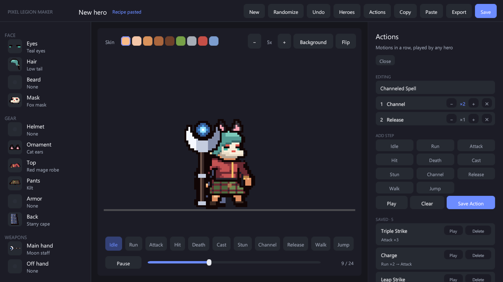

# Custom actions

**Actions** in the editor's top bar chains motions into a named action, such as a three-hit combo or a channel-and-release spell.

1. Press motions under **Add step**. Pressing the same motion again counts up its repeat; **−** / **+** change it later and **✕** removes the step (up to 12 steps, 9 repeats each).
2. For **Channel**, the repeat is the number of channel loops before the next step (add **Release** after it).
3. **Play** tries the action on the preview hero, **Save Action** stores it under its name (the same name replaces it), and clicking a saved action loads it for editing.

Actions name motions, not weapon styles, so one action plays on every hero with that hero's own version of each motion. They are kept in `Units/LegionActions.asset`, which every hero saved in that folder references. When an action ends the hero returns to idle, unless the last step is **Death**.

Five examples are included: Triple Strike, Charge, Leap Strike, Channeled Spell and Last Stand.

To play actions from your game, see [Heroes in code](using-heroes.md#custom-actions-in-code).
