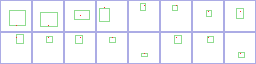
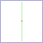

# Your own parts and weapons

The catalog is built from the image files of every [content pack](content-packs.md) in the project. When a pack is added or removed, or images are added to or removed from one, the catalog rebuilds itself the next time the editor is in focus; this takes under a minute. To rebuild by hand, for example after redrawing an image at the same size, run **Tools > Pixel Legion Maker > Build Catalog**.

Put your own art in a pack of your own outside `Assets/PixelUnitStudio`, so package updates never touch it.

## Parts

Parts go in `Parts/<Slot>/<name>.png`.

- A part image is a 256×64 slot sheet that uses the same cell layout as the rig. See `Rig/part_guide.png` and `Rig/body_template.png`. Only fill the cells your slot draws (for example the Head cell for Hair, Mask and Ornament).
- An optional `<name>_full.png` (the part drawn on the 29×42 full body, `Rig/base_body_full.png`) is used as the card icon.
- Outline color is (16, 5, 5). Draw the character facing left.
- Import settings: Sprite, point filter, no compression.

## Weapons

Weapons go in `Weapons/<kind>_<name>.png`.

- One square image (48, 64, 80 or 96 pixels). The image center is the grip. The blade points left. See `Rig/weapon_guide.png`.
- The first word of the file name picks the motion style: `sword`, `axe`, `mace` (default swing), `spear`, `staff`, `bow`, `crossbow`, `gun`, `dagger`, `throw`, and heavy weapons `greatsword`, `greataxe`, `hammer`, `club`, `halberd`, `scythe`. Names starting with `shield` are shields.
- Keep one-handed weapons about 16–26 pixels from grip to tip so they stay above the ground in every motion.

## Projectiles

Projectiles go in `Projectiles/<style>_<name>.png` (16×16, pointing left). The first word is the weapon style that shoots it: `bow`, `crossbow`, `gun` or `staff`.

## Dyeing

Dyeing recolors the most common color group of a part with one of the dye palettes, keeping its light and shade steps.
