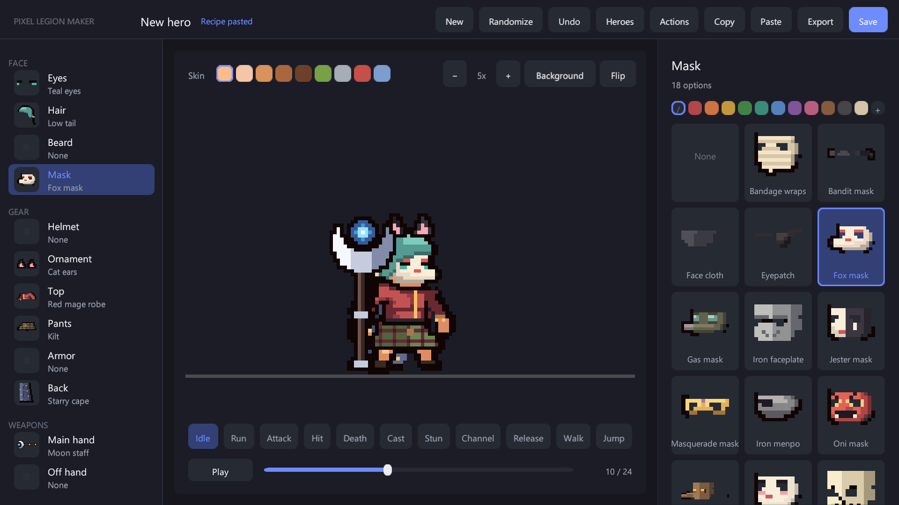
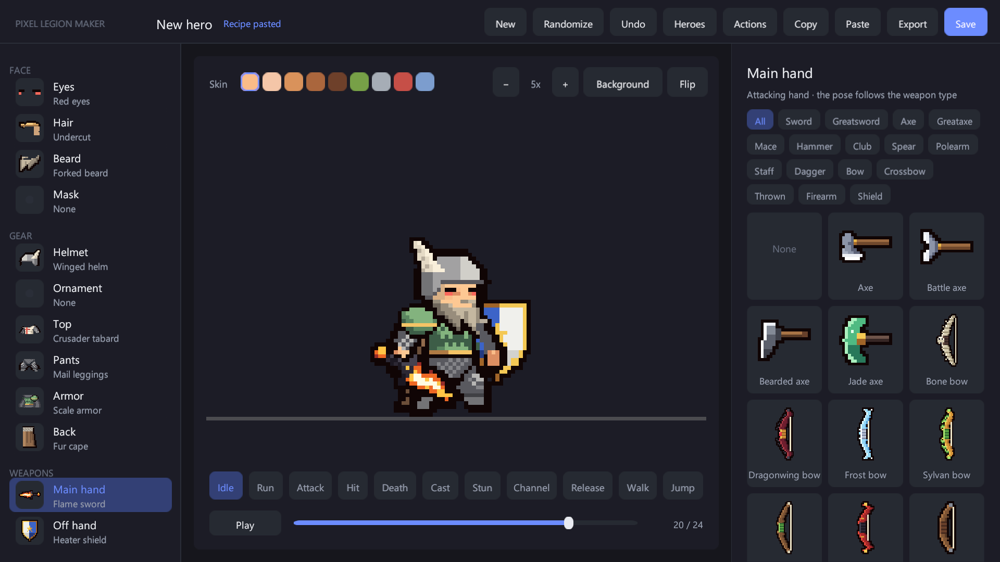
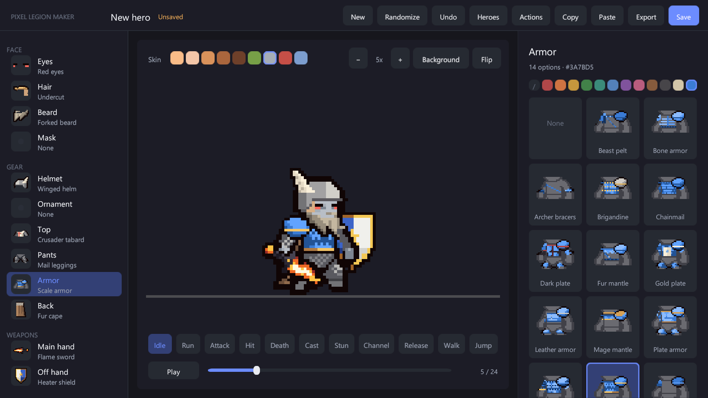

# The hero editor

The editor is a play-mode tool (`Scenes/LegionEditor.unity`). Open it with **Tools > Pixel Legion Maker > Open Editor** and press **Play**. The screen has three columns.

- **Left: slots.** Face: Eyes, Hair, Beard, Mask. Gear: Helmet, Ornament, Top, Pants, Armor, Cape. Weapons: Main hand, Off hand. Each row shows the current part.
- **Center: preview.** The **Skin** row recolors the body and the skin drawn on parts (pale, tan, brown, dark, orc, undead, demon, frost); weapons keep their colors. Zoom with **−** / **+**, change the backdrop with **Background**, mirror with **Flip**. The buttons below play each motion. **Pause** and the slider step through frames.
- **Right: parts.** All parts for the selected slot. Weapons can be filtered by kind. Swatches dye the selected part. **+** opens hue, saturation and brightness sliders for a custom color; the five light-to-dark shades are made from it.

## Top bar

| Button | Action |
|---|---|
| New | Start from the default hero |
| Randomize | Random combination (seeded, always a valid hero) |
| Undo | Undo the last change |
| Heroes | Open the saved hero library (load, delete) |
| Actions | Open the [custom action](custom-actions.md) panel |
| Copy / Paste | Copy the hero as a [recipe](recipes.md) line to the clipboard, or apply a recipe from the clipboard |
| Export | Write the [frame sheet](sheets-and-camera.md) of the current hero |
| Save | Save the hero as a prefab |

## Weapons decide the pose

The main hand is the attacking hand. Its weapon decides the motion style: sword swing, spear thrust, bow shot, staff cast, heavy two-handed slam, dagger, thrown weapon or firearm. The off hand holds a shield, a second weapon or a decorative item.

## Dyes and skin tones

Dyeing recolors the most common color group of a part with a palette or a custom color, keeping its light and shade steps. Glow colors of the glowing eyes are kept when other parts are dyed.

## Saving

**Save** writes `Units/HERO_<NAME>.prefab`. The hero library lists your heroes and, under their titles, the heroes of other [content packs](content-packs.md).
