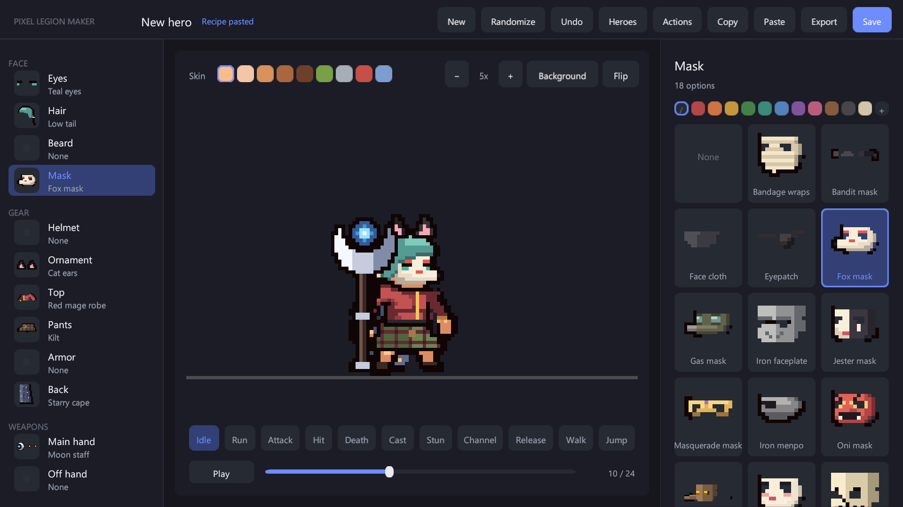

# Pixel Legion Maker

A hero builder for small pixel-art characters in Unity 6. Combine parts, weapons and dyes in a play-mode editor, then use the result as a ready-to-play prefab, build heroes at runtime from a one-line recipe, or export frame sheets for any engine.

Every hero stands about 44 pixels tall (32 pixels per unit) on one shared bone rig, so all parts and weapons fit every hero and every motion.

## What you can do

- **Build heroes** from 187 parts and 85 weapons and shields, 8 skin tones, 11 dye palettes and any custom color. [The hero editor](hero-editor.md)
- **Play them** with 12 motions for each of 9 weapon styles, animation events for hit, cast and end, and projectiles. [Heroes in code](using-heroes.md)
- **Chain motions** into named actions such as a three-hit combo, played by every hero with its own weapon style. [Custom actions](custom-actions.md)
- **Assemble heroes at runtime** from recipes or random seeds. [Runtime recipes](recipes.md)
- **Export frame sheets** with JSON metadata, and render crisp pixels with the included camera. [Frame sheets and camera](sheets-and-camera.md)
- **Add your own art** as PNG files in a content pack that package updates never touch. [Content packs](content-packs.md)

## Requirements

| Item | Requirement |
|---|---|
| Unity | 6000.0 or newer (developed and tested on 6000.0.47f1) |
| Render pipeline | Built-in or Universal (URP, including the 2D renderer). HDRP is not supported. |
| Input | Input Manager (old), Input System package, or both |
| Packages | uGUI (`com.unity.ugui`, in the default Unity templates) is required. 2D Sprite (`com.unity.2d.sprite`) is used when present for rebuilding the catalog but is not required. Test Framework is optional (for the included tests). |
| Platforms | Any platform that supports SpriteRenderer and Animator |

Start with the [Quick start](quick-start.md).
