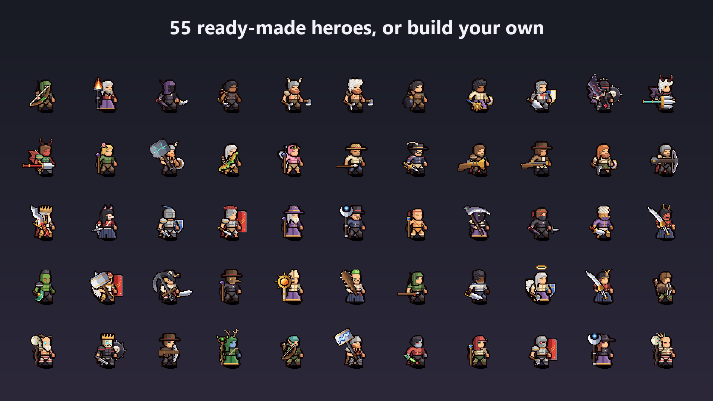
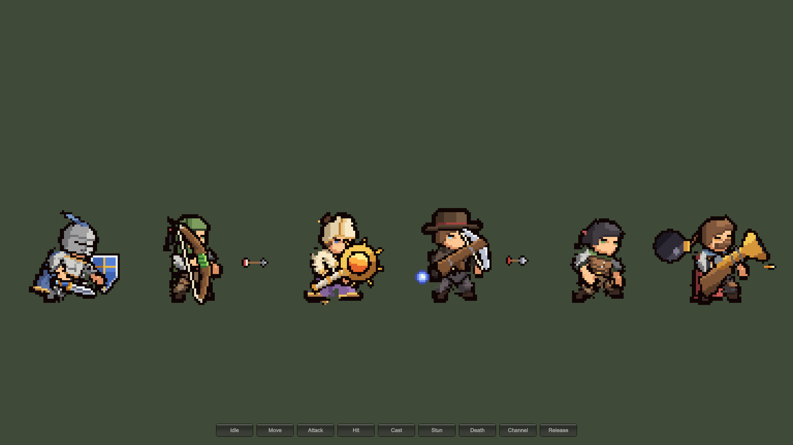

# Quick start

1. Import the package. Everything lives in `Assets/PixelUnitStudio/`.
2. Choose **Tools > Pixel Legion Maker > Open Editor** and press **Play**.
3. Pick a slot on the left (Eyes, Hair, Helmet, Main hand, ...), then a part on the right. Click a color swatch to dye the part, or **+** to mix any color. Pick a skin tone above the preview.
4. Press **Save** and give the hero a name. The prefab is written to `Assets/PixelUnitStudio/Units/HERO_<NAME>.prefab`.
5. Open **Tools > Pixel Legion Maker > Open Game Sample** and press **Play** to see saved heroes act in a scene.

55 example heroes are included in `Units/` (knight, priest, ninja, witch, fencer, crusader, vampire, orc, fairy and more).

## Samples

| Scene | Shows |
|---|---|
| `Samples/LegionGameSample.unity` | Saved heroes attacking, shooting projectiles on hit events and playing custom actions |
| `Samples/LegionAssemblySample.unity` | Six heroes built at runtime from recipes and seeds; **Shuffle** rebuilds them and **Dye** recolors them |

Open them with **Tools > Pixel Legion Maker > Open Game Sample** and **Open Assembly Sample**. **Open Editor** returns to the hero editor.

## Menu

| Tools > Pixel Legion Maker | Does |
|---|---|
| Open Editor | Opens the hero editor scene |
| Open Game Sample / Open Assembly Sample | Opens a sample scene |
| Online Documentation | Opens this manual |
| Build Catalog | Rebuilds the part catalog by hand (it also rebuilds by itself, see [Your own parts and weapons](custom-art.md)) |
| Export Saved Hero Sheets | Writes frame sheets for every saved hero ([Frame sheets](sheets-and-camera.md)) |
| Build Animations, Build Editor Scene, Import Rig and Open Preview | Regenerate the clips, the editor scene and the rig preview |
