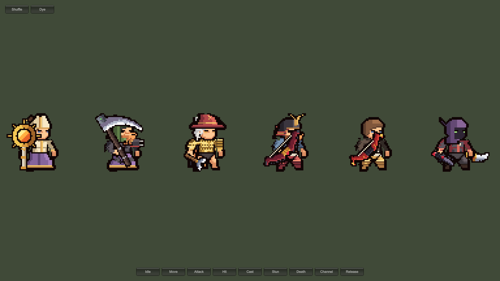

# Runtime recipes

Heroes can be built at runtime from the catalog (`Generated/LegionCatalog.asset`) without saved prefabs. A recipe is one line of `Slot=part[:dye]` pairs separated by spaces:

```
Helmet=helmet_mitre Cloth=robe_priest:gold Pant=pants_robe WeaponRight=staff_sun
```

```csharp
using PixelUnitStudio;

var recipe = LegionRecipe.Parse(text);
foreach (var name in recipe.Missing(catalog)) Debug.LogWarning(name);
var hero = LegionBuilder.Create(catalog, recipe, parent);
hero.Play("attack");
hero.Choose("Helmet", "helmet_brim");   // swap a part (null clears the slot)
hero.Dye("Cloth", "azure");             // dye a slot (null restores the original colors)
hero.Dye("Hair", "#3A7BD5");            // any color as #RRGGBB
hero.SetSkin("orc");                    // skin tone (null for the original)
Destroy(hero.Root);
```

- Slots you leave out are empty, or use their default part.
- `Skin=<tone>` sets the skin tone, and a dye can be a palette name or `#RRGGBB`, for example `Hair=hair_bun:#3A7BD5 Skin=tan`.
- `LegionRecipe.Random(catalog, new System.Random(seed))` returns the same hero for the same seed.
- `LegionRecipe.From(unit)` and `LegionRecipe.From(builder)` turn a saved prefab or a live hero back into a recipe (`ToString()`).
- The **Copy** button in the editor gives you the recipe of the current hero.

`Samples/LegionAssemblySample.unity` builds six heroes from recipes and random seeds; **Shuffle** rebuilds them and **Dye** recolors them.



Slot names and dye names are listed in [Slots, dyes and content](reference.md).
