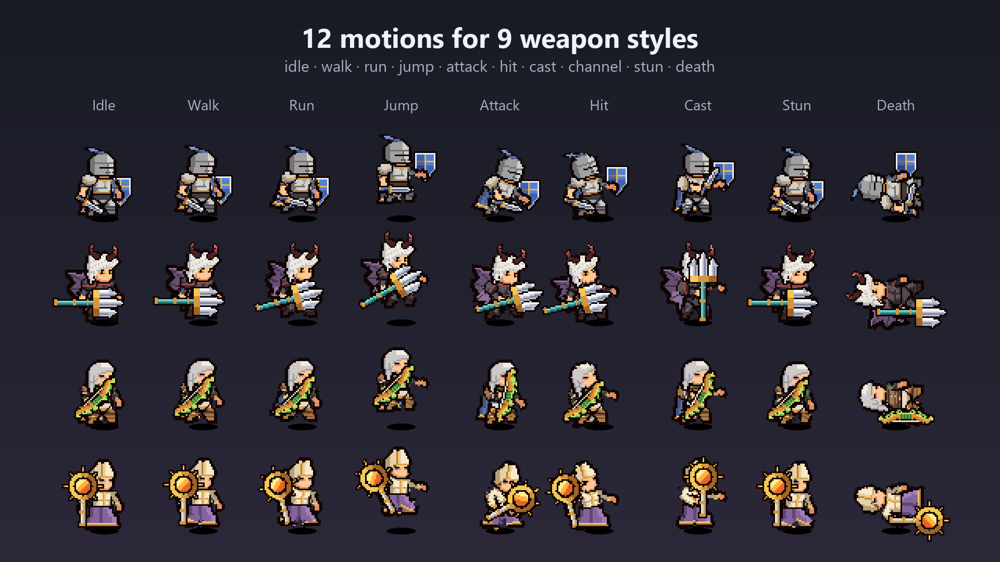

# Heroes in code

A saved hero is a normal prefab with an Animator.

```csharp
using PixelUnitStudio;

var hero = Instantiate(heroPrefab);
hero.transform.localScale = new Vector3(-1, 1, 1);   // the rig faces left; flip to face right
var unit = hero.GetComponent<LegionUnit>();
unit.Play("attack");
```

- Motions: `idle`, `running` (run), `walk`, `jump`, `attack`, `damaged`, `death`, `cast`, `stun`, and the channel set `cast_start` → `cast_loop` → `cast_end`. `jump` jumps in place; move the hero from your game code.
- `LegionUnit.Play` chooses the right version of the motion for the weapon kind (`attack@spear`, `attack@bow`, ...).
- One-shot motions (`attack`, `damaged`, `cast`, `cast_end`, `jump`, `death`) stop on their last frame. Tick **Return To Idle** on the hero's `LegionEvents` component to go back to idle automatically (death stays down).
- `cast_start` plays once and then loops `cast_loop` automatically. Play `cast_end` when the channel ends.



## Custom actions in code

Saved heroes carry a `LegionActionPlayer` that knows the actions made in the editor ([Custom actions](custom-actions.md)).

```csharp
var actions = hero.GetComponent<LegionActionPlayer>();
actions.Play("Triple Strike");                      // false if the library has no such action
actions.Finished += action => Debug.Log(action.name + " done");
```

Hit and cast events fire for every step, so projectiles and damage work as with single motions. `Return To Idle` waits until the whole action ends. Playing a motion with `LegionUnit.Play` stops the action. Heroes built at runtime use `builder.Actions` (set its `library`, or pass a `LegionAction` to `Play`).

## Animation events

Every saved hero has a `LegionEvents` component. The clips call it at the moments a game needs:

| Event | When |
|---|---|
| `hit` | The attack connects: the blade lands, the arrow, bolt, bullet or orb leaves, the thrown weapon leaves the hand |
| `cast` | The spell is released (`cast`, and the end of `cast_start`) |
| `end` | The last frame of a one-shot motion |

```csharp
var events = hero.GetComponent<LegionEvents>();
events.returnToIdle = true;
events.Fired += (name, state) => { if (name == LegionEvents.Hit) DealDamage(); };
// or wire onHit / onCast / onEnd in the inspector
```

The string `state` is the animator state, for example `attack@bow`.

## Projectiles

Bows, crossbows, guns and staves shoot a projectile sprite from `Projectiles/` (arrow, bolt, bullet, orb). Thrown weapons fly as the weapon itself on an arc and spin through prebuilt turns, so pixels never smear.

```csharp
events.Fired += (name, state) =>
{
    if (name != LegionEvents.Hit) return;
    var shot = LegionProjectile.Launch(catalog, unit, target.position);   // null for melee weapons
    if (shot != null) shot.Arrived += _ => DealDamage();
};
```

`LegionProjectile.Launch(builder, target)` does the same for heroes built at runtime. Projectiles snap to the 1-pixel grid and only fly; your game decides what they hit.

Use point filtering and an orthographic camera. See [Pixel-perfect camera](sheets-and-camera.md#pixel-perfect-camera) for crisp pixels at any screen size.
